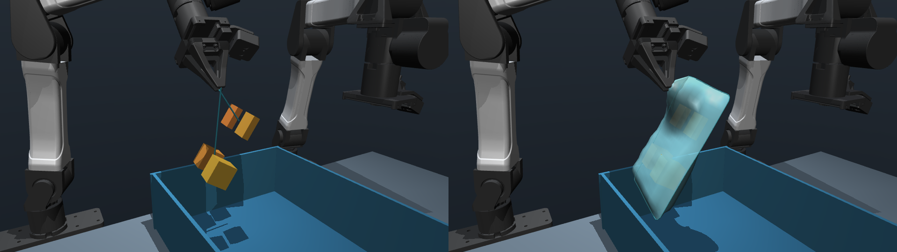

# Yam_B Policy V3 架构与训练结果

本轮完成了四块双柔索代理上的 **30 轮 Contextual PPO、5 次评分器协同验证和 200 个独立初态的留出评估**。学习 Try 加完整本体反馈的入篮率为 **48.0%**。采用同一个 Informed 评分器时，相比固定 Try 的配对提升为 **9.6 个百分点**，95% CI 为 **+2.5 至 +16.7 个百分点**。最佳固定抓取达到 **68.5%**。训练末轮的试探接触率为 **12.3%**，低于 50% 的告警线。

训练档为单张 RTX 5090 上的 **16,384 路**，约 **88,326 个有效宏回合/分钟**。最终模型版本为 `policy_version=30`、`scorer_version=1`。这是一轮 Stage A 代理预训练。蒙皮预览使用同一条已录制的 C0 轨迹，高保真薄膜起皱、撕裂和真机闭环属于后续验证。 [原始运行报告](stage-a/v1_rl_report.md) · [蒙皮回放](https://github.com/pig27777/yam-bag-rl/releases/download/v3-stage-a/yam_surrogate_skin_demo.mp4)

## 1. 一次闭环的数据流

1. **Reset**。GPU 采样隐藏内芯、接触参数和公开外袋几何。CPU 收到公开的 12 维 `v0`。
2. **Try**。Probe Actor 生成 13 维试探动作。GPU 控制器完成靠近、下压、扫掠及撤回 `q_hover`，持续写入 25 Hz 的本体反馈历史。
3. **选抓姿**。GPU 生成 16 个连续候选。CPU Grasp Scorer 接收 `v0`、实际 Try 命令、掩码历史和候选池，对池内候选打分并选取最高分。
4. **执行抓取**。GPU 控制器执行靠近、夹紧、提拉、搬运、张爪和落稳。末端只返回一份宏回合结果和物理审计。
5. **训练更新**。C2/C4 以实际执行候选的入篮标签训练评分器。C3 用末端奖励更新 Probe Actor，特权 Critic 提供价值基线。

每个宏回合只有一次 Actor 决策。物理与执行器以 **2 ms** 为子步，每 20 个子步写入一帧历史。GPU 使用 MuJoCo/MJWarp 4.0.1 与 Warp 1.19.0，CPU 使用单线程 PyTorch 2.15.0+cpu。回合内的主要数据交换发生在 Try 前、Try 后和任务结束。 [GPU 环境](../src/yam_bag_rl/envs/surrogate_env.py) · [执行与训练入口](../src/yam_bag_rl/envs/surrogate_run.py)

## 2. 模型输入与输出

| 模块 | 输入 | 网络与输出 | 使用阶段 |
|---|---|---|---|
| Probe Actor | `v0 [N,12]` | `12 → 64 → 13` 两层线性网络，中间 SiLU。输出 13 维高斯均值，另有 13 个可学习 `log_std` | 训练、评估和部署 |
| Privileged Critic | `v0 [N,12]` 与 `s0 [N,14]` | `26 → 64 → 1`，预测一次宏回合的价值 | 训练 |
| History Encoder | `H_try [N,69,62]`、有效掩码、阶段窗口及 13 维 Try 命令 | 三层残差因果 TCN，输出 `z_try [N,32]` | 完整反馈和去 Effort 评分器 |
| Grasp Scorer | `v0`、13 维 Try、`z_try` 和 `G [N,16,11]` | 候选 MLP、池内居中、FiLM 和线性读出，输出 `[N,16]` logits | 训练、评估和部署 |
| 控制器 | Try 或选中抓姿、当前关节与夹爪反馈 | 笛卡尔目标经差分 IK 转成六轴和夹爪命令 | 训练、评估和部署接口 |

`s0` 的 14 个字段为总质量、横向偏重、填充比例、纵向偏重、内芯偏航、桌面摩擦、柔索刚度和阻尼、两根柔索的静长、第一根柔索的摩擦系数、接触软刚度、内芯平面两个半尺寸。部分字段按固定尺度缩放。内芯状态、柔索张力、求解器接触力和碰撞标签用于 Critic、训练标签或诊断，各自经过独立接口。Actor 的输入始终只有 `v0`。 [网络实现](../src/yam_bag_rl/policy_v3/models.py) · [隐藏状态与域随机化](../src/yam_bag_rl/envs/surrogate_scene.py)

### 公开视觉特征 v0

`v0 = [center_xyz, frame_x_xyz, frame_y_xyz, half_extent_xyz]`。各段均为 3 维。中心和半尺寸单位为 m，两个方向向量为无量纲单位向量，第三轴由叉积得到。方向向量按外袋在工位坐标系中的两列轴向依次打包。训练基准外袋半尺寸为 **(0.111, 0.083, 0.012) m**，公开位姿和尺寸来自与隐藏态分开的随机流。

训练阶段关闭逐环境 RGB 渲染。操作界面的相机画面可单独显示。真机接入时，相机链路需要先提取外袋中心、轴向及半尺寸，再打包为这 12 个数。现有 Actor 和 Scorer 的张量输入接口可以沿用。 [公开几何产生逻辑](../src/yam_bag_rl/envs/surrogate_scene.py)

### Try 动作

完整语义为 `[p0(3), r0(3), delta_p1(3), delta_p2(3), gripper_cmd(1)]`。训练时从高斯采样，经 `tanh` 映射到 `[-1,1]`。留出评估用高斯均值做确定性输出。0-based 启用索引为 **0、1、5、8、9、10、12**。

| 启用分量 | 控制器映射 |
|---|---|
| `p0.x, p0.y` | 外袋坐标系内分别为 `0.68 × half_x × a[0]` 与 `0.61 × half_y × a[1]` |
| `r0.z` | 绕外袋局部 Z 轴相对悬停姿态转动 `0.32 × a[5]` rad |
| `delta_p1.z` | 下压位移 `-0.025 + 0.013 × a[8]` m，可变范围为向下 12–38 mm |
| `delta_p2.x, delta_p2.y` | 局部 XY 扫掠，各轴 `0.030 × a[9 或 10]` m |
| `gripper_cmd` | 下压和扫掠目标开度 `0.064 + 0.015 × a[12]` m |

起始高度相对 `v0` 中心为 `half_z + 12 mm`。未启用的动作分量置零。Actor 的 log-prob、熵和 KL 只使用启用维度。log-prob 应用 `tanh` 的 Jacobian 修正。底层另有工位范围裁剪、关节位置及速度限幅和夹爪力矩限幅。 [动作掩码与时序](../src/yam_bag_rl/envs/surrogate_env.py) · [动作映射与守护](../src/yam_bag_rl/envs/surrogate_control.py)

### 抓取候选与输出

每个候选为外袋局部坐标系的 11 维向量 `[position(3), rotation_6d(6), pregrasp_width(1), effort_limit(1)]`。位置和开度单位为 m，effort_limit 单位为夹爪电机 N·m。旋转用两个方向向量表示，控制器正交化后构造第三轴。生成器以公开外袋几何和独立候选种子为输入，每轮连续扰动位置、姿态、开度和力矩。C1 的候选池半数为几何引导模板，半数从允许范围内连续均匀采样。PPO 与正式留出评估使用 16 个扰动几何模板。

实际执行时，评分器输出的是候选分值，外层 `argmax` 选中一条抓姿。控制器负责后续轨迹、速度和力矩限制。训练数据每个回合有一条被执行候选的真实二元标签，其余候选参与池中心化。 [候选生成及夹爪映射](../src/yam_bag_rl/envs/surrogate_control.py) · [监督训练](../src/yam_bag_rl/envs/surrogate_learning.py)

## 3. 观测与 TCN-FiLM

Try 历史有 **69 帧**，共 **2.76 s**。依次是靠近 18 帧、下压 13 帧、扫掠 13 帧、撤回 25 帧。每个回合另存时间戳、有效掩码与阶段号。TCN 使用掩码和阶段号，时间戳保留供同步和审计。

| 每帧 0-based 索引 | 字段 | 单位 |
|---|---|---|
| 0–5 | 六轴关节位置 | rad |
| 6–11 | 六轴关节速度 | rad/s |
| 12–17 | 六轴实际下发位置命令 | rad |
| 18–23 | 六轴位置跟踪误差，命令减测量 | rad |
| 24–29 | 六轴原始 effort，经过模拟反馈退化 | N·m |
| 30–35 | 六轴 effort 减标称静重力偏置 `tau_res` | N·m |
| 36–39 | 夹爪开度、速度、电机 effort、开度误差 | m、m/s、N·m、m |
| 40–42 | FK 末端位置 | m |
| 43–48 | FK 末端两列方向向量 | 无量纲 |
| 49–51 | 末端位置误差 | m |
| 52–54 | 末端姿态误差旋转向量 | rad |
| 55–61 | 实际命令记录，六轴目标和夹爪开度 | rad、m |

静重力偏置使用冻结名义 Yam_B MJCF 的零速度动力学。模拟反馈以 2 ms 更新，依次应用 gain、回合级 bias、噪声、死区和一阶低通，再经离散延迟和降采样写入历史。臂侧 gain 为 0.91–1.10，bias 为 ±0.050 N·m，噪声标准差 0.010–0.028 N·m，死区 0.012–0.030 N·m。夹爪的 bias、噪声和死区按 0.19 倍缩放。低通时间常数为 9–22 ms。每个 effort 通道在训练回合内有 20% 概率整段置零，对应原始 effort 和残差同时屏蔽。闭环留出评估关闭这项 dropout。 [反馈与历史打包](../src/yam_bag_rl/envs/surrogate_control.py)

### 残差和排序机制

1. 在 C1 训练集的靠近窗口，以公开命令的一次项和二次项做岭回归，得到 27 × 62 的时序基线。取真实反馈减基线的残差，用训练集均值和标准差归一化。冻结这些统计量并随 checkpoint 保存。完整模型保留 62 通道，去 Effort 版保留 49 通道。
2. 对真实残差和零残差基线使用同一组 32 通道、卷积核长 3、扩张率 1/2/4 的因果残差 TCN。下压和扫掠各做 masked mean 与 max pooling，拼成 128 维表示。两路表示相减，接上 32 维 Try 动作编码，经线性层和 LayerNorm 得到 32 维 `z_try`。
3. 将 `v0 + a_try + g` 拼成 36 维，每候选经 `36 → 48 → 32` MLP，再减去候选池均值。由 `z_try` 经 `32 → 32 → 64` 生成各 32 维的 `gamma` 和 `beta`。FiLM 输出为 `(1 + gamma) * h_grasp + beta`，最终线性层输出一个 logit。部署可用 sigmoid 得分，排序可直接用 logits。
4. 同一候选池内，`beta` 对全部候选产生同一个偏移，会改变绝对分值和 BCE。候选名次差随 `gamma` 的通道缩放改变。Blind 把历史隐向量设为零，仍保留公开 `v0`、Try 命令和抓姿。去 Effort 版屏蔽原始关节力矩、关节力矩残差和夹爪力矩。

[History Encoder](../src/yam_bag_rl/envs/surrogate_learning.py) · [FiLM 读出](../src/yam_bag_rl/policy_v3/models.py)

## 4. Reward、标签与安全守护

Probe Actor 的末端奖励为

```text
R = Y_bin - w_t × probe_time - w_e × effort_cost - w_i × lift_instability
```

| 项 | 实际计算 |
|---|---|
| `Y_bin` | 入篮并通过最终审计记 1。有效物理下的滑脱、抓空、没有提起、超时和正常安全停止记 0 |
| `probe_time` | 下压及扫掠期间，在相应有效记录中至少一轴速度超过 0.04 rad/s 的帧数除以 26 |
| `effort_cost` | 下压及扫掠期间，在 2 ms 子步上对六轴 `min(abs(tau_res)/3 N·m, 1)` 求平均 |
| `lift_instability` | 提拉及搬运中任一内芯块的最大速度除以 0.7 m/s，再裁到 [0,1] |
| `max_Q` | 候选最高预测分，仅写日志 |

第 1–10 轮的 `(w_t, w_e, w_i) = (0.01, 0.01, 0.03)`。从第 11 轮线性增大，第 22 轮达到并保持 `(0.05, 0.05, 0.05)`。接触率单独计数和告警。该奖励允许接触更少的 Try 在最终入篮改善时得分提高。

入篮成功要求四块均进入有效篮区、柔索已释放、最终净空低于 12 mm、峰值净空超过 125 mm，且最大末速度低于 0.020 m/s。最终还检查柔索、求解、刚体碰撞、Try 撤回和抓取安全停止标记。物理无效轨迹从 BCE 和 PPO 优势估计中剔除。

| 守护场景 | 触发条件与处理 |
|---|---|
| Try 卸载 | 任一关节的 `abs(tau_res) > 2.2 N·m`，或夹爪 effort 超过 0.33 N·m，或任一关节跟踪误差超过 0.21 rad。目标抬高 9 mm，张爪后撤回 |
| 抓取限幅 | 对应阈值为 5.5 N·m、0.77 N·m、0.32 rad。触发后张爪并标记抓取失败 |
| 物理无效 | 非有限状态、严重穿模、柔索数值爆炸、硬求解器溢出等。直触超过 120 N 触发核心穿模审计 |
| PPO 熔断 | 当轮无效率超过 2% 跳过更新。连续两轮超过 3%，或连续三轮跳过，停止训练并记录诊断 |

扭矩和跟踪误差阈值为代理环境的工程先验。真实系统需要使用实机的电机力矩标定、观测延迟和安全控制配置。 [奖励实现](../src/yam_bag_rl/envs/surrogate_run.py) · [安全控制](../src/yam_bag_rl/envs/surrogate_control.py) · [物理与入篮审计](../src/yam_bag_rl/envs/surrogate_scene.py)

## 5. 训练配置与结果

### C0、采集和评分器

GPU 共同输入对照覆盖 64 路、每路 64 个子步。悬空耦合最大张力误差为 **1.07 × 10⁻⁵ N**，最大净空误差为 **1.86 × 10⁻⁷ m**，捕获判定逐项一致。四工况闭环均有入篮样本，共 **69 条**，其中 **19 条**满足空侧抓持及吊起入篮。定向补测中，距中心 83 mm 的空侧抓持成功 4/16，92、100、106 mm 档各为 0/16，扁平满装近中心档成功 29/32。 [C0 审计](stage-a/c0_closed_loop.json) · [悬空耦合等价性](stage-a/c0_suspended_gpu.json) · [极端抓取补测](stage-a/extreme_case_comparison.json)

C1 正式波次从 16,384 回合取得 16,163 条有效样本，入库 8,192 条，正率 **46.9%**。按初态组拆分为 5,734 / 1,229 / 1,229 个训练、验证及测试样本。总质量在 150–400 g 间连续抽样，正式运行采用松装左偏、松装右偏、中等居中、扁平满装四个分层，分层内部连续随机化内芯几何、偏重、柔索参数、摩擦与接触顺应性。跨四层全区间混合留待另一个训练配置验证。 [C1 数据](stage-a/c1_dataset_summary.json)

C2 使用未加权 BCE，AdamW 学习率为编码器 `1e-3`、评分头 `3e-4`，weight decay `1e-2`，dropout 0.20，batch size 384，最多 80 epoch。按验证 BCE 早停并恢复最佳权重。

| C2 模型 | 实跑 epoch | 测试 BCE | 测试 AUROC | 测试 Brier |
|---|---:|---:|---:|---:|
| Informed | 43 | 0.604 | 0.694 | 0.215 |
| Blind | 80 | 0.575 | 0.728 | 0.202 |
| Informed w/o Effort | 47 | 0.594 | 0.703 | 0.211 |

Blind 在 C1 留出样本上的逐候选离线指标最佳。完整 Informed 在后续学习 Try 固定快照闭环中选出的抓姿入篮更多。两项结果分别衡量采集数据中已执行候选的排序能力和整池 argmax 后的真实入篮。隐藏质量、偏重和填充比例的线性探针 (R^2) 在这批测试中接近零。 [C2 日志与诊断](stage-a/c2_training_metrics.json)

### C3、C4 与并发

C3 每轮发起 16,384 个独立宏回合。以 `R − V(s0,v0)` 为标准化优势，PPO 每轮最多 4 epoch，minibatch 2,048。Actor / Critic 学习率为 `3e-4 / 1e-3`，clip epsilon 0.20，目标 KL 0.02，熵权重 0.01，价值损失权重 0.50，联合梯度裁剪 0.50。正式 30 轮共发起 **491,520** 个宏回合，**487,865** 个有效。首轮到末轮入篮率由 **31.9%** 升到 **46.7%**，末轮无效率 **0.38%**。试探接触率由 **55.2%** 降到 **12.3%**，26 轮低于 50%。 [PPO 逐轮记录](stage-a/ppo_progress.jsonl) · [学习曲线](stage-a/c3_c4_learning_curves.png)

C4 每 6 轮尝试一次。最近有效 on-policy 数据与 C1/历史数据各占约一半，按工况与成功标签分层，每次约 16.4k 样本。候选评分器微调 15 epoch，编码器 / 评分头学习率为 `3e-4 / 1e-4`。候选在 C1 独立验证及近期诊断的 BCE 都需要在原模型 +0.005 以内。5 次候选在近期诊断集的 BCE 均下降，在 C1 独立验证上均未达到发布线。最后一次独立验证 BCE 为 0.5931，原评分器 0.5874，发布上限 0.5924。因此最终评分器保留版本 1。 [C3/C4 汇总](stage-a/c3_c4_training_summary.json)

| 并发环境 | 有效宏回合/分钟 | GPU 总占用峰值 GiB |
|---:|---:|---:|
| 1,024 | 20,065 | 8.12 |
| 2,048 | 35,532 | 8.27 |
| 4,096 | 52,990 | 8.58 |
| 8,192 | 72,309 | 9.21 |
| **16,384** | **88,326** | **10.47** |
| 24,576 | 94,243 | 11.68 |
| 32,768 | 94,012 | 12.94 |

计时覆盖 Reset、Try、抓取、搬运、释放、观测、审计及 CPU 推理。24,576 和 32,768 路补测相对正式训练档分别提高 6.7% 和 6.4%，低于 10% 扩容门槛。 [并发基准](stage-a/scaling_benchmark.json)

### 留出闭环

200 个独立初态每个工况 50 个。同 Try 的评分器从同一个 Try 后快照出发，使用相同候选池，各自选抓姿。固定 Try 对照在相同初态重新执行固定动作。Best Fixed 是从采集样本选出的固定几何模板，位次 5，直接执行抓取。Oracle 逐个试验池内 16 个候选并取成功上界。

| 闭环组 | 有效入篮 | 成功率 |
|---|---:|---:|
| Best Fixed | 137 / 200 | **68.5%** |
| Vision-Only No Try | 13 / 200 | 6.5% |
| Matched Blind | 8 / 200 | 4.0% |
| Fixed Try + Informed | 76 / 198 | 38.4% |
| Learned Try + Informed w/o Effort | 24 / 200 | 12.0% |
| Learned Try + Informed | 96 / 200 | **48.0%** |
| Privileged Oracle | 200 / 200 | 100.0% |

| 学习 Try + 完整反馈相比 | 配对初态 | 提升百分点 | 分层 Bootstrap 95% CI |
|---|---:|---:|---:|
| 同 Try 的 Blind | 200 | +44.0 | [+37.0, +51.5] |
| 固定 Try + 同一 Informed | 198 | +9.6 | [+2.5, +16.7] |
| 同 Try 的去 Effort 评分器 | 200 | +36.0 | [+28.5, +43.5] |

学习 Try 加完整反馈在松装左偏、松装右偏、中等居中、扁平满装的成功率分别为 **52%、42%、56%、42%**。力矩消融比较的是两套分别训练的评分器在共用 Try 快照上的实际表现。最佳固定抓取仍领先，联合训练中的试探接触也明显下降，主动信息采集是否稳定有效需继续在更高保真和实机闭环验证。 [配对结果](stage-a/held_out_evaluation.json) · [分工况图](stage-a/closed_loop_by_regime.png)

## 6. 部署接口与复核

部署所需的模型包包括 Probe Actor、完整反馈评分器、Action Mask 与冻结的 `active`、`baseline`、`mu`、`sigma`。相机输出 12 维公开外袋几何。机器人反馈按上表构造 25 Hz 的 69 帧批次，并保留命令、阶段、有效位和时间戳。抓取候选以同一外袋坐标系表示，交给评分器排序。Critic 及其隐藏输入留在训练链路。 [真机反馈映射接口](../src/yam_bag_rl/robot/yam_interface.py)

生产代理覆盖四块积分、单向柔索、显式滑脱和有限表面接触。周一参考实现中的颈部阻尼与扭转在冻结复放回归中验证。首轮 C3 曾因离开指垫的翻转包裹产生异常直触而熔断，修复接触空间判定后重新完成正式训练和 24 项回归。蒙皮为回放中的双面半透明外袋几何，跟随原始内芯和指垫轨迹，保留原回合的动作、碰撞与奖励记录。 [回归日志](stage-a/regression-check.log) · [首轮熔断诊断](stage-a/attempt-01-pre-contact-fix/physics_circuit_breaker.json) · [蒙皮前后对照](stage-a/yam_surrogate_skin_comparison.png)


